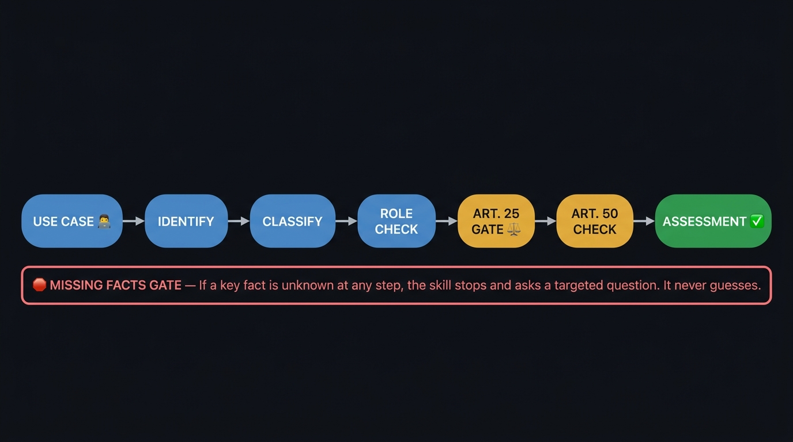

# EU AI Act Compliance Skill 🤖📜

[_2024%2F1689-003399?style=flat-square)](https://eur-lex.europa.eu/eli/reg/2024/1689/oj)

> 🌐 **Ecosystem Availability:** Indexed and listed on [**MCPRush**](https://mcprush.com/trivicm/eu-ai-act-compliance-gatekeeper-v1-0-0) — the marketplace for Model Context Protocol (MCP) servers and AI agent skills — under **EU AI Act Compliance Gatekeeper (v1.1.0)**.

> **"Do I need to label this as AI-generated, or am I good to go?"**

If you develop software, create content, or integrate AI agents and models, this is a question you will inevitably face.

The European Union's landmark AI legislation (**EU AI Act — Regulation (EU) 2024/1689**), complemented by the European Commission's Guidelines on Article 50 (20 July 2026), sets out transparency obligations that apply from **2 August 2026**. The rules depend on the type of AI output, your legal role, and the specific context of use:

* 🏷️ **Provider obligations (Article 50(1) & 50(2)):** Providers of AI systems interacting directly with natural persons must inform users that they are interacting with AI, unless this is obvious from the circumstances and context. Providers of AI systems generating synthetic audio, image, video, or text must ensure that outputs are marked in a machine-readable format as artificially generated or manipulated, subject to the conditions and exceptions set out in Article 50.
* 📢 **Deployer obligations (Article 50(3) & 50(4)):** Deployers must inform natural persons exposed to emotion recognition or biometric categorisation systems, and must disclose AI-generated or manipulated deepfakes and AI-generated or manipulated text published to inform the public on matters of public interest — unless the content has undergone appropriate human review or editorial control by a person holding editorial responsibility.
* ✅ **Exceptions exist** — but they are narrowly defined. Routine editing tasks that do not substantially alter the semantics of input (such as technically auxiliary processing) may fall outside marking obligations. Whether a specific use case qualifies requires a fact-specific assessment.

This project functions as a **smart digital judge and compliance assistant**. Its mission is to provide developers, creators, and organizations with instant, precise compliance assessments grounded directly in EU law.

---

### 📦 Repository Contents

1. 🧠 **`SKILL.md` (Rules & Orchestrator):** The core instruction set that guides your AI assistant on how to analyze use cases, ask targeted questions, and deliver legally sound assessments.
2. 📚 **`references/` (Legal Knowledge Base):** Verified reference guides covering key provisions of the EU AI Act — including Article 50 (transparency and marking obligations) and Article 25 (distinguishing *Provider* vs. *Deployer* responsibilities).

---

### 🔍 Assessment Pipeline

Every compliance question goes through a structured evaluation process — from identifying the type of AI involvement, through determining your legal role and checking applicable articles, to delivering a final assessment:

If a key fact is missing at any step (e.g., who controls the user interface, or whether a model was substantially modified), the skill stops and asks a targeted question before proceeding. It never guesses.

---

### 🚀 Installation & Usage

#### STEP 1: Install in Your Environment

* **Option A — Via AI Agent Marketplace ([MCPRush](https://mcprush.com/trivicm/eu-ai-act-compliance-gatekeeper-v1-0-0)):**
  Access and install the verified **EU AI Act Compliance Gatekeeper (`v1.0.0`)** listing directly via the [MCPRush Agent Skills Marketplace](https://mcprush.com/trivicm/eu-ai-act-compliance-gatekeeper-v1-0-0).
* **Option B — Direct Package / Repository Install:**
  Download the ready-made **`eu-ai-act-compliance.skill`** package from the [GitHub Releases](https://github.com/TrivicM/eu-ai-act-compliance-skill/releases) page, or copy this repository folder directly into your AI assistant or IDE skills directory (e.g., `.gemini/skills/`, `.agents/skills/`, or Claude/Cursor/Codex skill folders).

#### STEP 2: Ask in Plain Language
In your normal conversation with your AI assistant, simply describe what you are building or publishing:

> *"I am building a website and using AI tools to generate product images. Do I need to display an AI transparency label?"*

The assistant will automatically load this skill, evaluate your request against the relevant legal articles, and provide an accurate assessment with actionable next steps.

---

### 📝 Input Formats

No rigid format is required. Simply specify:
* What the AI system is doing (generating text, image, video, audio, or code).
* Where and how the output will be published (blog, social media, news portal, internal tool).
* Whether a human reviews and exercises editorial control before publication.

---

### ⚠️ Legal Disclaimer

This skill provides compliance assessments based on the official text of the EU AI Act (Regulation (EU) 2024/1689) and relevant official Commission guidance, including the Commission Guidelines on transparency obligations under Article 50 (adopted 20 July 2026) and the Code of Practice on Transparency of AI-Generated Content. The Commission itself notes that the Guidelines complement and clarify the obligations set out in Article 50. This skill is designed as a practical decision-support tool for initial compliance checks and does not constitute formal legal advice from a licensed attorney. The reference materials are structured summaries of the relevant legal provisions; where current-law verification is required, the skill follows its living-law rule and verifies the applicable text against EUR-Lex before reaching a conclusion.

---

### 📌 Project Metadata

| Parameter | Value |
| :--- | :--- |
| **Skill Version** | `1.1.0` |
| **Marketplace Listing** | [MCPRush — EU AI Act Compliance Gatekeeper (`v1.1.0`)](https://mcprush.com/trivicm/eu-ai-act-compliance-gatekeeper-v1-0-0) |
| **Legal Baseline Date** | `2026-11-08` |
| **Primary Legislation** | EU AI Act — Regulation (EU) 2024/1689 (Articles 25 & 50) |
| **Commission Guidelines** | Transparency obligations under Article 50 — European AI Office (2026) |
